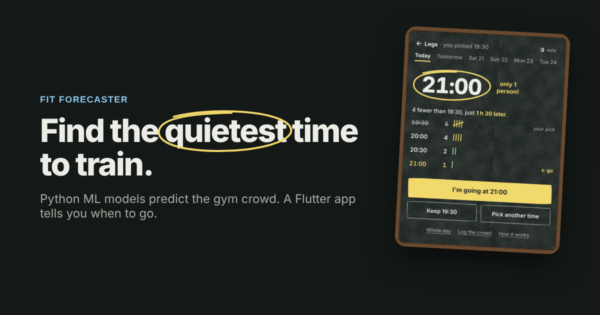

# Fit Forecaster

**Find the quietest time to train at the gym, near the time you want.**

Pick a body group (Arms, Back, Cardio, Chest, Core, General or Legs) and a time. Fit Forecaster
predicts how busy every half hour will be, moves you to the quietest one within 90 minutes, and
tells you why.

- **Website:** LIVE_LINK
- **Try the demo:** LIVE_LINK/app/
- **How the models work, explained simply:** LIVE_LINK/study.html



## Two versions

Fit Forecaster started as a **group college project** (version 1). **Version 2** is a rebuild by
V, working with Claude (an AI assistant) as a pair programmer.

Version 1 reported an R² of 0.91, but the score was inflated: the models were tested on rows they
had already learned from, and one clue included the answer. Crowd reports from users were never
used, and the app showed a chart instead of an answer.

Version 2 fixed each of those, one measured step at a time:

1. **Honest testing:** learn from earlier days, get graded on later ones (R² 0.91 → 0.78).
2. **Fixed data:** empty half hours count as 0, "yesterday" is the real day before, no clue peeks.
3. **Better models:** Poisson XGBoost, tuned Random Forest, a new clue, weighted 45/45/10 (R² 0.80 of a possible 0.81).
4. **A more realistic gym:** simulated members skip days, rest and switch workouts (harder on purpose).
5. **Learning that works:** real reports replace simulated counts; the models relearn every 10 reports.
6. **One clear answer:** two steps instead of a chart, after seven design rounds.
7. **A Flutter phone app** on a FastAPI server, and a website that explains it all.

The full story, with the reason for every change: [docs/STORY.md](docs/STORY.md).

## Results

Tested on the last 6 of 30 simulated days, which the models never saw while learning:

| | |
|---|---|
| Average miss | **1.9 people** per half hour |
| Within 2 people | **2 out of 3** guesses |
| R² (averaged over body groups) | **0.51** |
| vs. "the usual crowd for this time" | better in **6 of 7** body groups |
| When the app moves you | you meet about **2.3 fewer people** |

Every number comes from `backend/experiments/study.py`.

## How it works

1. **Data:** a weekly timetable of 5,000 gym members (7 files, one per weekday).
2. **Simulated visits:** there's no log of real visits, so a month is simulated from the timetable.
3. **13 clues** per half hour: time, day, yesterday, last week, recent averages, the usual crowd. Only earlier days are used.
4. **Three models per body group:** XGBoost 45%, Random Forest 45%, Linear Regression 10%.
5. **The rule:** look 90 minutes either side of your time, pick the quietest half hour, keep yours if moving saves less than half a person.

## What's in this repo

```
backend/    Python: data, simulation, models, FastAPI server, Streamlit app, experiments
app/        Flutter phone app (chalkboard / whiteboard look)
website/    The project website, ready for Vercel (static HTML, no build step)
docs/       The version 1 vs version 2 story, and version 1's notebook and plan
```

## Run it

**Backend (Python 3.10+):**

```
cd backend
pip install -r requirements.txt
python train_and_test.py              # trains the models, about a minute
streamlit run app.py                  # the app in your browser
uvicorn api.server:app --port 8000    # the API for the phone app (docs at /docs)
```

**Phone app (Flutter 3.27+):** see [app/README.md](app/README.md).

**Website:** open `website/index.html`, or deploy the `website` folder to Vercel
(see [website/README.md](website/README.md)).

## Built with

Python, pandas, NumPy, scikit-learn, XGBoost, FastAPI, Streamlit, Flutter (Dart).

## Credits

- **Version 1:** a group college project ([original repo](https://github.com/abelshinev/fit_forecaster)).
- **Version 2:** V, with Claude as an AI pair programmer.
- Fonts: Inter (SIL Open Font License), plus Rubik Spray Paint and Permanent Marker in the
  Streamlit app's street theme; licences are next to the font files.
